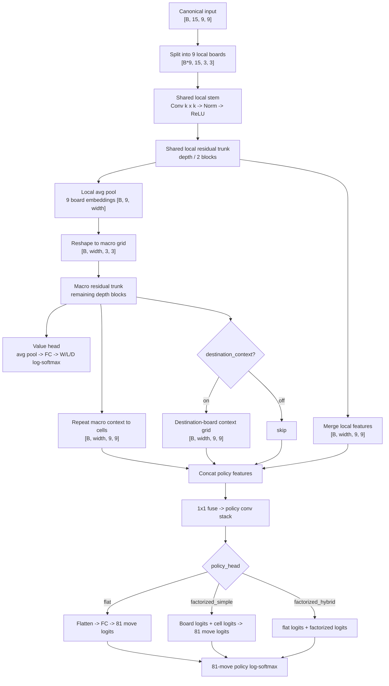
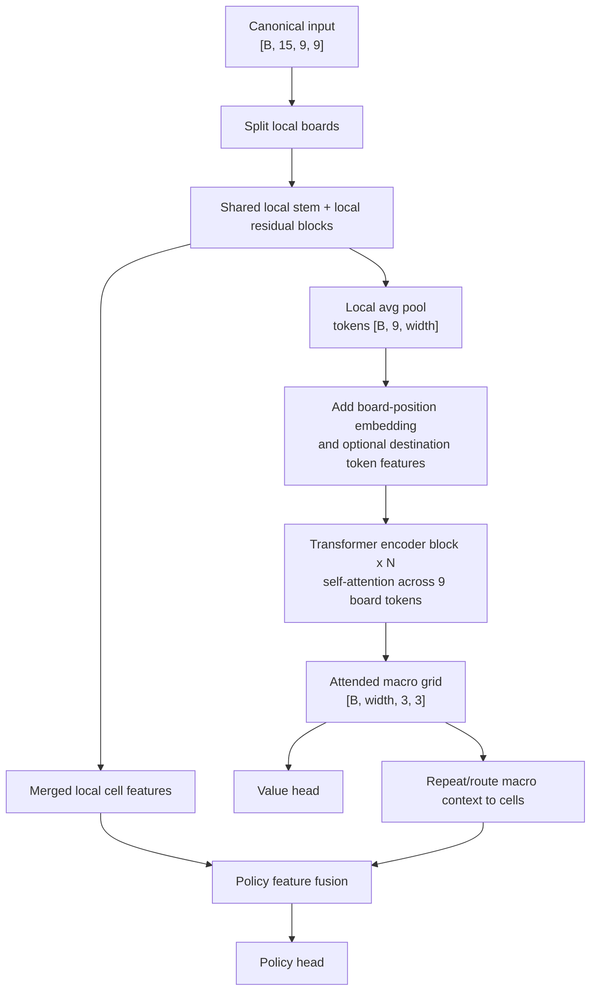

# UTTT Model Architecture

This documents the current UTTT network path and the transformer-style macro
board block I would test next.

## Current Input

The game now emits a 15-plane canonical tensor with shape `[B, 15, 9, 9]`.
Planes are relative to the player to move:

| Plane | Meaning |
| --- | --- |
| 0 | Current-player stones |
| 1 | Opponent stones |
| 2 | Last move |
| 3 | Legal moves |
| 4 | Forced destination board |
| 5 | Current-player won boards |
| 6 | Opponent won boards |
| 7 | Closed boards |
| 8 | Legal moves that give opponent free choice |
| 9 | Current-player local board winning moves |
| 10 | Opponent local board winning moves |
| 11 | Current-player macro-board winning moves |
| 12 | Opponent macro-board winning moves |
| 13 | Legal moves that send opponent to a local win threat |
| 14 | Opponent moves that would send current player to a local win threat |

## Current Hierarchical Network



The important property is that the same 3x3 local encoder is reused for all
small boards. The macro trunk then reasons over the 3x3 grid of small-board
summaries.

## Proposed Transformer Macro Block

The transformer block would replace or augment the macro residual trunk. The
local encoder and policy/value heads can stay almost unchanged.



## Why Attention Fits UTTT

The current macro CNN can only mix information through spatial convolutions on
the 3x3 macro grid. That works, but every macro board is treated mainly through
nearby grid geometry.

Self-attention lets each small-board token directly ask every other small-board
token what matters. In UTTT, that is useful because a move in board 0 can send
the opponent to board 8, a threat in board 5 can matter because it completes a
macro diagonal, and the strongest move can depend on non-local board relations.

A conservative PyTorch implementation would be:

```python
self.board_pos = nn.Parameter(torch.zeros(1, 9, width))
self.macro_attn = nn.TransformerEncoder(
    nn.TransformerEncoderLayer(
        d_model=width,
        nhead=4,
        dim_feedforward=4 * width,
        dropout=0.0,
        activation="gelu",
        batch_first=True,
        norm_first=True,
    ),
    num_layers=2,
)

tokens = local_emb.view(batch_size, 9, width) + self.board_pos
tokens = self.macro_attn(tokens)
macro = tokens.view(batch_size, 3, 3, width).permute(0, 3, 1, 2).contiguous()
```

That keeps the existing one-hot last-move plane and all tactical planes. It does
not throw out the local CNN; it only changes the macro-board reasoning stage.
